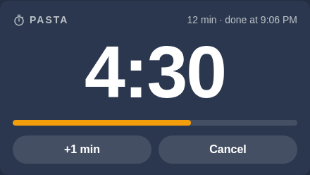
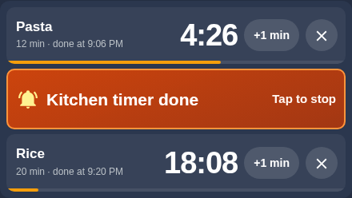
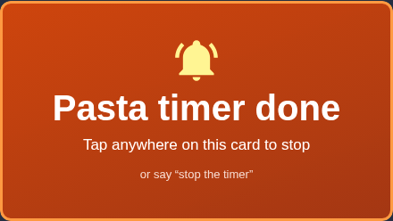

# Kitchen Timers

"Okay Nabu, set a pasta timer for 10 minutes." In the kitchen, any timer or countdown you ask for goes to the wall display: up to three at once, each with its own name. The display shows them in big digits. When one runs out, its row turns amber and the display chimes until someone taps it, and the voice assistant says which one is done.

| One timer | Three at once, one done | Done |
|---|---|---|
|  |  |  |

## Only in the kitchen

Every voice assistant in the house can set timers, and in every other room they still work the way they always have: the timer lives on that room's speaker. The kitchen is different because the kitchen display is right there and the cook needs to see the countdown from the stove. So the kitchen voice assistant, and only that one, sends every timer request to the display.

That takes a little care. Home Assistant's simplest custom voice commands are matched on the words alone, on every voice assistant in the house, so they can't be limited to one room. These timers use custom sentences that only count when the request comes from a voice assistant in the Kitchen area. Anywhere else, the same words fall through to the built-in timers as before.

## Why not the oven's own timer?

The wall oven is a connected Café double oven, and Home Assistant can write its kitchen timer. The oven even counts it down, but its touchscreen only draws a timer that was started on the touchscreen itself. A remote one runs invisibly and can't be dismissed at the oven. The SmartHQ app has no kitchen timer either: its "timer" is Cook Time, which starts a timed bake, and a kitchen timer must never be able to switch an oven on. So the timers live in Home Assistant, on the kitchen display everyone can see from the stove.

## How it works

```
"set a pasta timer for 10 minutes"            tap +1 min / ✕ / tap to stop
        │ (kitchen voice assistant only)                 │ (kitchen display card)
        ▼                                                │
 kitchen sentences ── voice script ──► script.kitchen_timer_relay ◄──┘
 (matched in the Kitchen area)  (reads lengths   the only thing that changes the timers
                                 and names)              │
                                   three timer slots (survive restarts), each with a name
                                                         │ one runs out
                                                         ▼
                     its row turns amber ── display chimes every 5 s (up to 10 min)
                                         └─ voice assistant: "Pasta timer is done."
```

- **Voice** is matched locally in a fraction of a second, before any AI agent sees it.
- **One script** owns the timers. The display card and the voice commands both call it, so "add 5 minutes", the +1 min button and the spoken replies all follow the same rules.
- **The display card** swaps into the slot of the family's cruise countdown while any timer runs or rings, and the countdown comes back when they're all done. With one timer the card shows big digits; with two or three it shows one row each. Rows keep their places while timers come and go, so a row never moves under your finger. Both cards are exactly the same size, so nothing else on the pixel-tuned dashboard moves.

## What you can say

| Say | Reply |
|---|---|
| "Set a timer for 5 minutes", "start a ten minute countdown" | "Timer set for 5 minutes." |
| "Set a pasta timer for 10 minutes", "set the oven timer for 35 minutes" | "Pasta timer set for 10 minutes." |
| "How long is left on the pasta timer?" | "About 8 minutes left on the pasta timer." |
| "What timers are running?", "how much time is left?" | "Two timers. Pasta has about 8 minutes left and the timer has 2 minutes left." |
| "Add 2 minutes to the pasta timer", "give me five more minutes", "add 30 seconds" | "Added 2 minutes to the pasta timer. About 10 minutes left." |
| "Take a minute off timer two" | "Took 1 minute off Timer 2. 2 minutes left." |
| "Pause the pasta timer", "resume the pasta timer" | "Pasta timer paused." |
| "Cancel the pasta timer", "cancel all timers" | "Pasta timer canceled." / "Both timers canceled." |
| "Stop the timer" (while one is ringing), "stop the timers" | "Pasta timer stopped." |

A timer without a name is "Timer", then "Timer 2" and "Timer 3"; on the display the first one reads "Kitchen timer". A fourth timer gets a polite no: "The kitchen already has three timers running, pasta, rice and the timer. Cancel one first." When more than one timer is running and you don't say which, questions get an answer about all of them and pause or resume applies to all of them. "Five more minutes" or "cancel the timer" goes to the timer that just went off. Otherwise the reply lists the names and asks you to pick one instead of guessing.

Hours, minutes and seconds work in digits or words ("an hour and a half", "ninety seconds"). If the length can't be understood, the reply asks again instead of guessing.

## The chime

The chime is a short three-note bell synthesized by the browser on the display, so there is no sound file to host. It plays every five seconds while any timer is done and nobody has stopped it: tap that timer's row, say "stop the timer", or wait ten minutes. Each timer stops on its own, so tapping one never silences another. Only the kitchen display chimes: the card compares the screen's own network address with the one the network currently reports for the kitchen display, so a new address doesn't silence it. The second wall display shows the same timers silently. The display allows sound without a tap, but if audio is ever blocked, a small "Tap for sound" badge appears and any tap turns sound back on. The voice assistant's announcement plays either way.

## Built with

- Helpers: `timer.kitchen_timer_1` to `_3`, each with a name (`input_text`) and a ringing flag (`input_boolean`)
- `script.kitchen_timer_relay`, `script.kitchen_timer_voice` and `automation.kitchen_timer_ring_and_announce` (`home-assistant/` in the repo)
- Kitchen-only custom sentences (`home-assistant/custom_sentences/en/kitchen_timers.yaml`) and their `intent_script` handler (`home-assistant/packages/kitchen_timer.yaml`)
- `kitchen-timer-card`, a custom Lovelace card (`home-assistant/cards/unifi-connect/kitchen-timer/`)
